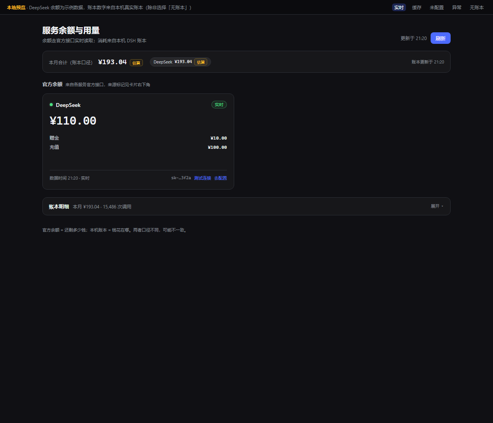

# dsh-usage-panel · 服务余额与用量面板

DSH 桌面端（DeepSeek Harness）的侧边栏页面：把两件事分开摆清楚——**各服务官方余额还剩多少**，以及**本机 DSH 这个月钱花在哪**（账本 + 会话统计，标「估算」）。

> 当前版本 **0.5.5（P0 + P0.1 + P1 + P2 + P3 + P4 + UI 优化 + 平台跳转 + 侧栏告警 + 账本优化）**。
> P1 新增：MiniMax Token Plan 订阅额度卡、阿里云 BSS 余额卡、按会话统计（会话日志 + 内置定价）。
> P2 新增：自定义数据源（URL + 请求头 + JSON 取值路径）、余额阈值告警（卡片标红 + 可选桌面通知）。
> P3 新增：同一服务多 Key（每 Key 独立余额/额度行）、余额/账本/会话 CSV 导出。
> P4 新增：MiniMax 按量（PAYG）Key 自动查 `account/query_balance`，卡片显示按量余额。
> UI 优化：等高三列卡片、数字放大、显式高对比按钮、状态/时间层级。
> 侧栏告警：红色圆点 = 余额归零，橙色圆点 = 任一项低于该卡配置的阈值；不做轮询。
> 账本优化：概览 KPI、近 7 天趋势 + 每日明细、模型 Tokens/花费占比、按会话 Top 20 排名与占比。
> 平台跳转：阿里云改为中国站 `billing-cost.console.aliyun.com`。
> 平台跳转：每张内置服务卡（含未配置态）提供「打开平台 ↗」，新标签页直达 DeepSeek 用量页、MiniMax 对应区域余额页、阿里云费用控制台。
> 开发计划、优先级与状态以 **[PLAN.md](PLAN.md)** 为准。
> 真实 API 调用需要各自的 Key，目前**未测**；下文会逐项标注。



另有 [账本明细 + 按会话](docs/panel-details.png)、[三服务异常态](docs/panel-error.png)、[未配置态](docs/panel-unconfigured.png)、[服务配置](docs/panel-config.png)、[缓存态](docs/panel-cached.png)、[自定义数据源卡](docs/panel-custom.png)、[阈值告警态](docs/panel-alerts.png)、[告警配置](docs/panel-config-alerts.png)、[自定义源配置](docs/panel-config-custom.png)。

---

## 一、功能

| 能力 | 说明 |
| --- | --- |
| 侧边栏入口 | 侧边栏「用量」行，点开是全局面板 |
| 跨服务汇总条 | 本月合计 + 各服务本月消耗（账本口径，**估算**）；账本更新时间 |
| DeepSeek 卡 | 官方余额（总额 / 赠金 / 充值）；多币种主数字取 CNY，其余币种单列 |
| MiniMax 卡 | **订阅 Key**：Token Plan 5 小时/每周额度；**按量 Key**：账户余额（自动探测，不显示假百分比） |
| 阿里云卡 | BSS `QueryAccountBalance`：可用额度 / 现金余额 / 信控额度 / 网商信用 / Quota 限额 |
| 自定义数据源卡 | 最多 8 个；手填 URL + 请求头 + JSON 取值路径；请求头 Token 只存 Host；取值必须是数字 |
| 阈值告警 | 按服务/自定义源设阈值，严格低于才标红；可选桌面通知（Notification API，一天一次） |
| 账本明细 | 展开后：本月花费/调用/Tokens/今日概览；近 7 天趋势 + 每日调用与消耗；按模型显示 Tokens、调用、花费、占比；按会话 Top 20 排名、占比，可滚动 |
| 按会话统计（懒加载） | 展开明细时扫描本月会话日志，按内置价表估算每个会话的消耗 / 调用 / Token；只返回标题与数字 |
| 侧栏告警 | 「用量」图标右上角：红点=余额归零，橙点=低于已配置阈值；打开面板/刷新快照时更新，不做后台轮询 |
| 平台跳转 | 每个内置服务卡（含未配置态）有「打开平台 ↗」，新标签页打开官方控制台；阿里云使用中国站 `billing-cost.console.aliyun.com`；自定义源不提供 |
| 多 Key | 每个内置服务最多 4 把：主 Key + 最多 3 把附加 Key；附加 Key 各有余额/额度行；不伪造按 Key 的请求消耗 |
| CSV 导出 | 余额 / 账本 / 会话三份 CSV；UTF-8 BOM + CRLF；Key 只导出 mask |
| 手动刷新 | 页头刷新全部；每张卡「测试连接」只测自己 |
| Key 打码 | 页面只收到掩码；明文仅在 Host 端 |
| 失败降级 | 5 秒超时 + 单服务错误态；有缓存则显示旧值并标「缓存」；任一服务失败不影响其它卡 |
| 配置页 | 五个页签：三个服务、告警、自定义数据源；每服务含附加 Key 管理 |

页面结构：

```
服务余额与用量                                        更新于 21:34  [刷新]
本月合计（账本口径） ¥194.71 [估算]  [DeepSeek ¥194.71 估算]   账本更新于 21:34
官方余额  来自各服务官方接口，来源标记见卡片右下角
┌ DeepSeek ────────┐ ┌ MiniMax ─────────┐ ┌ 阿里云 ──────────┐
│ ¥110.00          │ │ 62% 5 小时窗口    │ │ ¥10,000.00       │
│ 赠金/充值         │ │ general 62%·周38%│ │ 现金/信控/Quota   │
│ 数据时间 · 实时    │ │ 套餐/用量/重置    │ │ 数据时间 · 实时    │
└──────────────────┘ └──────────────────┘ └──────────────────┘
账本明细  本月 ¥… · N 次调用                      展开 ▾
（展开：近 7 天趋势 / 按模型 / 按会话）
官方余额 = 还剩多少钱；本机账本 = 钱花在哪。两者口径不同，可能不一致。
```

---

## 二、安装

**当前没有替你安装**（安装会改 profile，需要确认）。二选一：

### 方式 A：插件管理器

DSH → 设置 → 插件 → 安装，填入：

```
E:/Data/Project/DeepSeekHarness/DSH-Homemade-Plugins/dsh-usage-panel
```

### 方式 B：手工登记

`~/.dsh/profiles/desktop/package.json`：

```jsonc
{
  "dependencies": {
    "dsh-usage-panel": "file:E:/Data/Project/DeepSeekHarness/DSH-Homemade-Plugins/dsh-usage-panel"
  },
  "dsh": {
    "profile": {
      "bundles": [ /* …已有条目… */ "dsh-usage-panel" ]
    }
  }
}
```

然后 `cd $HOME\.dsh\profiles\desktop; pnpm install`，重启 DSH。

---

## 三、配置（按服务）

打开「用量」→ 卡片或配置页 → 选择对应服务页签。

### DeepSeek

| 字段 | 说明 |
| --- | --- |
| API Key | DeepSeek 开放平台创建，`sk-` 开头 |
| API 根地址 | 默认 `https://api.deepseek.com`，走代理时才改 |

保存后点卡片「测试连接」验证。余额接口只回答「还剩多少钱」，不提供消耗。

### MiniMax

| 字段 | 说明 |
| --- | --- |
| API Key | **订阅 Key**（Token Plan）或**按量 API Key**（PAYG） |
| 区域 | 中国大陆 `www.minimax.cn` / 国际 `www.minimax.io`，按 Key 所属站点选择 |

同一个字段现在支持两种 Key：

- **订阅 Key**：查 `GET /v1/token_plan/remains`，卡片显示 5 小时/周额度百分比。
- **按量 Key**：订阅接口返回 no-plan/拒绝时，自动改查 `GET {api-base}/account/query_balance`，卡片显示「按量余额 ¥X / $X」。
  - 国内 API base：`https://api.minimaxi.com`
  - 国际 API base：`https://api.minimax.io`
  - 余额接口是社区实测路径，不在 MiniMax 公开主文档的显著位置；真实 Key 未在本项目联调。

**按量 Key 不会显示 token 消耗明细**：余额接口只返回账户余额；控制台的账单历史是网页会话接口，需要 Cookie，不属于本插件接法。

### 阿里云（RAM 子账号）

1. 在 RAM 控制台创建一个**子账号**，不要用主账号 AccessKey；
2. 授予只读权限 `bss:DescribeAcccount`（BSS OpenAPI 的账户余额查询权限）；
3. 生成该子账号的 AccessKey ID + Secret，填入面板；
4. Endpoint 默认 `business.aliyuncs.com`，一般不用改。

面板显示 `Data.AvailableAmount` 等字段；`Success=false` 或鉴权失败会显示具体错误（AccessKey 无效 / 签名失败 / 无权限），不会显示假余额。

### 阈值告警

「服务配置 → 告警」：

- 可单独设 DeepSeek 余额、MiniMax 余额/剩余百分比、阿里云可用额度的阈值；
- 自定义数据源也可设阈值；
- `0` 或留空 = 不告警；只有**严格低于**阈值才标红（等于不告警）；
- 关闭「启用阈值告警」后，所有阈值都不生效；
- 侧栏图标圆点：**红色 = 余额归零**（不依赖告警开关）；**橙色 = 低于该卡已配置阈值**（需要启用阈值告警且阈值 > 0）；
- 圆点只在打开/刷新面板或客户端挂载时的一次性 snapshot 更新，不做后台轮询。
- 「桌面通知」默认关闭：使用浏览器 / Electron 的 `Notification` API，一天内同一服务同一阈值只通知一次；系统拒绝或 API 不存在时静默回退为页面标红，不影响面板。

### 自定义数据源

「服务配置 → 自定义数据源」：

1. 填名称、URL、JSON 取值路径（如 `data.balance`、`items[0].amount`）、币种；
2. 请求头每行一个 `Name: Value`（如 `Authorization: Bearer …`）；保存后页面只显示名称 + 掩码，编辑时留空表示保持原请求头；
3. 保存后自动刷新一次；最多 8 个。

限制：仅 `http`/`https`；URL 不能带用户名/密码；GET；5 秒超时；响应 JSON ≤1MB；请求头禁止 CR/LF、`Host`、`Content-Length` 等保留头；取值不是数字会显示错误，不会用 0 冒充。请求头可能含 Token，因此整份自定义源配置保存在 **Host 私有文件**，不进 `settings.json`。

### 多 Key

「服务配置 → DeepSeek / MiniMax / 阿里云 → 附加 Key」：

- 每个服务最多 4 把：主 Key（原有单 Key 字段）+ 最多 3 把附加 Key；
- 附加 Key 填标签 + 密钥（阿里云为 AccessKey ID + Secret），保存后自动查询一次；
- 卡片主数字仍是主 Key；附加 Key 在下方表格里显示各自余额/额度/状态；
- 一把附加 Key 失败只影响自己的行，不影响主 Key 或其它行；
- 凭据文件升级为 v3，旧 v2 单 Key 自动兼容，不会丢 Key。

**口径**：DeepSeek/阿里云的余额是账户级，同一账号的多把 Key 会显示相同余额；官方没有按 Key 的请求消耗接口，本地账本也不记录用了哪把 Key。因此这里**只做按 Key 的余额/额度**，不做「按 Key 消耗」的拆分；告警仍看主 Key。

### CSV 导出

页面底部三个链接：

- **导出余额 CSV**：一行一个 Key（服务、标签、mask、状态、余额/额度、告警、时间）；
- **导出账本 CSV**：近 7 天 daily 行 + 按模型行；
- **导出会话 CSV**：本月会话标题、调用、Token、估算成本、未定价调用。

编码为 UTF-8 BOM + CRLF，Excel 可直接打开；字段按 RFC4180 转义；只导出 Key 的 mask，不导出 Key/header 明文。会话标题可能含业务信息，导出前请确认落点。

### 存储与备选方式

| 文件 | 内容 |
| --- | --- |
| `~/.dsh/usage-panel/credentials.json` | v3：三个服务的主 Key + `extraKeys`（含明文，仅 Host），创建时 `0600`（Windows 上 `chmod` 为尽力而为，实际由用户目录 ACL 保护） |
| `~/.dsh/usage-panel/settings.json` | 非密配置：DeepSeek baseUrl、MiniMax region、阿里云 endpoint、告警阈值/开关、超时等 |
| `~/.dsh/usage-panel/custom-sources.json` | 自定义数据源（含请求头值），`0600`；已加入 `.gitignore` |
| `~/.dsh/usage-panel/balance-cache.json` | 各服务/附加 Key/自定义源上次成功结果（只含指纹，不含 Key/header 值） |

凭据文件结构见 [`examples/credentials.example.json`](examples/credentials.example.json)，配置见 [`examples/settings.example.json`](examples/settings.example.json)，自定义源见 [`examples/custom-sources.example.json`](examples/custom-sources.example.json)。

环境变量备选（两者同时提供才生效）：

```powershell
DEEPSEEK_API_KEY
MINIMAX_API_KEY
ALIYUN_ACCESS_KEY_ID + ALIYUN_ACCESS_KEY_SECRET
```

环境变量提供的凭据不能在页面里「清除」（接口返回 `key-from-env`）。插件**不读取** `~/.dsh/.credentials.yaml`。

---

## 四、接口与数据来源核实

| 数据源 | 状态 | 结论 |
| --- | --- | --- |
| DeepSeek 余额 | ✅ 已核实（2026-11-11 官网） | `GET /user/balance`，Bearer；`balance_infos[]`，金额是字符串；币种 CNY/USD。文档：<https://api-docs.deepseek.com/api/get-user-balance> |
| MiniMax Token Plan | ✅ 端点/字段已核实（社区实测 + 官方 FAQ），⚠️ 语义有历史坑 | `GET {cn}/v1/token_plan/remains`（`www.minimax.cn` / `www.minimax.io`），Bearer；订阅额度。**未用真实订阅 Key 调用** |
| MiniMax PAYG 余额 | ✅ 真实 Key 已直连验证（2026-11-12，返回 `available_amount=13.91` CNY） | `GET {api-base}/account/query_balance`（`api.minimaxi.com` / `api.minimax.io`），Bearer 按量 Key；响应字段 `available_amount`、`cash_balance`、`voucher_balance`、`credit_balance`、`owed_amount`；区域默认 CNY/USD。**界面待重启后验证** |
| 阿里云 BSS | ✅ 接口/返回字段已核实（官方文档） | `QueryAccountBalance`（BssOpenApi 2017-12-14），endpoint `business.aliyuncs.com`；返回 `Data.AvailableAmount/AvailableCashAmount/CreditAmount/MybankCreditAmount/Currency/QuotaLimit`；RAM 权限 `bss:DescribeAcccount`。**未用真实 RAM AccessKey 调用** |
| 本机 DSH 账本 | ✅ 本机实际文件 | `~/.dsh/dsh-usage/usage-ledger.json` v1：`days[date][provider][model]` 的 tokens/calls/cost；插件只读，不重算价格 |
| 会话日志 | ✅ 本机实际文件 | `~/.dsh/sessions/**/session.v4.jsonl.zstd`：多个 zstd 帧拼接，每帧一条事件；`session` / `session/title` / `assistant/message`（usage + `message.source.model` + time） |
| 自定义数据源 | ✅ 本机配置 + mock 网络 | 用户自填 GET URL + headers + JSON 路径；实现只接受数字；真实第三方接口 **未测** |
| 多 Key | ✅ 本机凭据 + mock 网络 | 每 Key 独立查询余额/额度；同账号 Key 会重复；**不拆分按 Key 消耗** |
| CSV | ✅ 本机数据 | 余额/账本/会话三份；BOM + CRLF；仅 mask，无 Key/header 明文 |
| DeepSeek 定价 | ✅ 官网核对（2026-11-11） | 1M tokens 单价；peak 01:00–04:00 / 06:00–10:00 UTC 工作日，其余半价；中国节假日不建模。文档：<https://api-docs.deepseek.com/quick_start/pricing> |

**未核实/未测**：MiniMax 真实订阅额度、阿里云真实余额、三家服务的真实网络错误路径、DSH 真机内的卡片渲染。mock 测试通过不等于真实接口已验证。

---

## 五、口径与降级

### 三种数字

1. **官方余额**：来自各服务接口，回答「还剩多少钱」；失败时不显示 0。
2. **账本消耗**（汇总条 / 账本明细）：来自 `usage-ledger.json`，回答「DSH 本机花了多少」；全部标「估算」。
3. **会话消耗**（按会话）：由会话日志的 usage 按内置价表重算，回答「钱花在哪个会话」；只覆盖 DeepSeek 已定价模型，未知模型计入 `unpricedCalls`，不编价格。

和 DSH 右下角状态栏的「今日消耗」口径可能略有差异：本页面以账本文件为准并标「估算」。

### 失败行为

| 情况 | 表现 |
| --- | --- |
| 未配置某服务 | 该卡虚线 + 该服务的「未配置」说明 + 去配置；不显示假 0 |
| 5 秒超时 | 该卡错误态；有缓存则显示旧值 + 过期提示 |
| DeepSeek 401/403 | 「Key 无效或已过期」/「没有读取余额的权限」 |
| MiniMax 1004 / 无订阅 | 「Key 无效」/「该 Key 没有可查询的订阅额度」 |
| 阿里云签名/权限 | 「签名校验失败」/「RAM 账号没有 bss:DescribeAcccount」 |
| 自定义源 401/超时/路径错 | 「数据源拒绝了请求」/「超时」/「JSON 路径没有取到值」；有缓存则显示旧值 |
| 低于阈值 | 卡片红色边框 +「低于阈值：…（当前 …）」；开启桌面通知且系统允许时额外提醒 |
| 桌面通知被拒/不存在 | 静默回退为页面标红，不影响面板 |
| 账本缺失/读失败 | 汇总条与明细显式提示；不显示 0 |
| 会话日志损坏 | 跳过并计数，接口仍 200；不影响其它会话 |
| Host 路由不可用 | 整页错误 + 重试，不是白屏 |

所有 provider 请求都在 Host 端：单请求 5 秒上限、不重试、不带 Key 进日志；前端不做 provider 请求，没有 CORS，也没有把 Key 放进页面存储。

---

## 六、开发与验证

```powershell
cd E:\Data\Project\DeepSeekHarness\DSH-Homemade-Plugins\dsh-usage-panel

# P0/P0.1 核心 + 路由 + 账本（50）
node test/host.test.mjs

# P1：MiniMax / 阿里云签名 / 会话统计 / 凭据隔离（29）
node test/p1.test.mjs

# P2：自定义源 / JSON 路径 / 告警阈值（17）
node test/p2.test.mjs

# P3：多 Key / 凭据迁移 / CSV（16）
node test/p3.test.mjs

# P4：MiniMax PAYG 余额 / 双段探测（9）
node test/p4.test.mjs

# 浏览器端：四卡 / 五页签 / 多 Key 行 / CSV 链接 / 会话表 / PAYG 卡 / 平台跳转 / 侧栏告警 / 账本优化（47）
node test/client.test.mjs

# 全部（168）
npm test
```

测试不联网、不需要真实 Key：provider/自定义源请求由记录器回答，会话日志在临时目录里由多帧 zstd 生成。

### 本地预览

```powershell
node preview/server.mjs
# http://127.0.0.1:8791/?mode=live
```

- `mode`：`live | cached | unconfigured | error | no-ledger | custom | alert`
- `&details=1`：展开账本明细（会加载预览会话表）
- `&panel=config | alerts | custom`：直接看配置页/告警页/自定义源页
- 预览中的三家余额、自定义源、会话行为示例数据；账本是本机真实账本（`no-ledger` 除外）。横幅会写明。

### 目录

```
dsh-usage-panel/
├─ PLAN.md                 # 工作文档：范围、验收、状态、变更记录
├─ package.json / cordis.patch.yml / icon.svg
├─ lib/
│  ├─ index.js             # Host：三内置服务 + 自定义源引擎、路由、缓存、会话入口
│  ├─ config.js            # 设置、凭据 v2、自定义源存储、打码、缓存
│  ├─ alerts.js            # 阈值判定（严格小于）
│  ├─ custom.js            # 自定义源校验、JSON 路径、请求
│  ├─ csv.js               # CSV 转义、BOM、三个 scope
│  ├─ remote.js            # 统一 deadline / 错误分类
│  ├─ deepseek.js          # GET /user/balance
│  ├─ providers/
│  │  ├─ minimax.js        # Token Plan remains
│  │  └─ aliyun.js         # RPC HMAC-SHA1 + QueryAccountBalance
│  ├─ ledger.js            # 账本读取、按天/按模型汇总
│  ├─ pricing.js           # DeepSeek CNY 价表 + peak 判定
│  ├─ sessions.js          # 多帧 zstd、会话聚合
│  └─ client.js            # 侧边栏入口 + 四类卡 + 五页签配置 + 折叠明细
├─ test/                   # 离线用例（host / p1 / p2 / p3 / client + harness）
├─ preview/                # 本地视觉预览（非插件运行时）
├─ examples/               # 配置样例（占位凭据 / 自定义源）
├─ scripts/                # 暂存区密钥扫描
└─ docs/                   # 截图
```

---

## 七、已知限制 / 未做

- **还没有在真机装过**：按约定停在安装前。真实 DSH 页面、真实接口、真实网络错误未验证。
- **真实 API 未测**：MiniMax 订阅 Key、阿里云 RAM AccessKey、DeepSeek 真实 Key 都没有调用过；测试全部是 mock/fixture。
- **自定义源真实网络未测**：只验证了配置、校验、JSON 路径与错误映射；第三方接口的实际响应格式需要你接上后看。
- **桌面通知未真机验证**：依赖浏览器/Electron 的 `Notification` 权限；离线只验证“调用一次/去重/不泄漏”的契约。
- **会话统计只在离线 fixture 上验证**：真实 527 个会话日志的全量扫描耗时与准确性未测；首次展开可能较慢（会显示加载态）。
- **会话定价有边界**：只内置 DeepSeek `deepseek-flash` / `deepseek-v4-pro` CNY 价；未知模型计 `unpricedCalls`；中国法定节假日未建模（按工作日算）；`cacheWrite` 无价格时不计价。
- **MiniMax 字段语义有风险**：`usage_count` 在不同端点/版本有「已用/剩余」两种解读；面板按「已用」并优先采用 `*_remaining_percent`，但真实响应未核。
- **MiniMax PAYG 余额端点**：`account/query_balance` 已用真实 Key 直连返回 `available_amount=13.91` CNY；但该路径不是 MiniMax 公开主文档的主 API，仍可能变动。余额接口不含 token 消耗明细，`account/amount` 需要网页 Cookie，未接入。
- **阿里云账单明细**：仍无官方接口；可用自定义源接第三方/自建接口。
- **自定义源不是 SSRF 边界**：URL 由本机用户填写，允许 loopback/内网地址（可能用于本地代理）；只限 http/https、禁 URL 内嵌凭据、禁保留头、5 秒超时。不要把它当成面向不可信用户的代理。
- **多 Key 只用 mock 验证**：真实多 Key 余额/额度、同账号重复、附加 Key 失败路径均未联调。
- **按 Key 消耗不可得**：DeepSeek/阿里云没有按 Key 用量接口，本地账本也不记录 Key；P3 只展示按 Key 余额/额度，不拆分请求消耗。
- **CSV 会话标题**：用户主动导出时标题会进入文件，可能含业务信息；请确认落点。
- **P3 已完成**：多 Key 余额/额度 + CSV。
- **P4 已完成**：PAYG 余额自动探测；真实 Key 已直连解析，界面待最后一次重启后验证。
- **Windows 文件权限**：`chmod 0600` 在 Windows 上不改变 ACL 语义，凭据/自定义源文件由用户目录/NTFS ACL 保护；多人共用时建议环境变量。
- **预览与生产 React**：预览用 React 17 UMD，插件运行在 DSH 自带 React 上。

---

## 八、验收对照

### P0 + P0.1

| # | 验收项 | 状态 |
| --- | --- | --- |
| P0-1 | DeepSeek 余额与官方一致 | ⏳ 待真机 + 真实 Key |
| P0-2 | 账本今日/本月与状态栏一致 | ⏳ 账本已核对；状态栏交叉验证待装 |
| P0-3 | Key 打码 / 测试连接 | ✅ 打码/接口已测；真实 Key 待装 |
| P0-4 | 断网错误态、不崩不卡 | ✅ 离线用例 |
| P0-5 | 刷新不阻塞 | ✅ 骨架屏 + 后台刷新 |
| P0-6 | 每卡更新时间与来源 | ✅ |
| A1–A7 | 汇总条 / 只放余额 / 折叠明细 / 页脚口径 / 缺失提示 / 回归 / 测试全绿 | ✅ |

### P1

| # | 验收项 | 状态 |
| --- | --- | --- |
| MM-1…MM-7 | MiniMax 解析、百分比、错误映射、超时、区域、打码、零值 | ✅ mock 全绿；真实订阅 Key **未测** |
| AL-1…AL-7 | 阿里云签名已知答案、请求不含 Secret、解析、错误映射、打码、endpoint、超时 | ✅ mock 全绿；真实 RAM **未测** |
| SS-1…SS-9 | 会话成本精确、重试去重、月份过滤、未知模型、损坏跳过、无正文、缓存、性能、UI 状态 | ✅ fixture 全绿；真实全量 **未测** |
| IN-1…IN-5 | 三卡并存、凭据迁移/隔离、服务名、回归、安全检查 | ✅ |

### P2

| # | 验收项 | 状态 |
| --- | --- | --- |
| CD-1…CD-8 | JSON 路径 / URL / 请求头校验、fetch 错误映射、保存删除、8 个上限、秘密不泄漏、缓存与隔离、UI 编辑 | ✅ mock 全绿；真实第三方接口 **未测** |
| ALRT-1…ALRT-6 | 严格阈值、四指标、快照 alert、标红、通知去重/开关/权限、配置校验 | ✅ mock 全绿；真实桌面通知 **未测** |
| P2-IN-1…3 | 4 类卡共存、P0/P1 回归、安全检查 | ✅ |

### P3

| # | 验收项 | 状态 |
| --- | --- | --- |
| MK-1…MK-8 | v2→v3 迁移、附加 Key 增删/上限、打码、分别查询、隔离、缓存、刷新语义、UI | ✅ mock 全绿；真实多 Key API **未测** |
| CSV-1…CSV-8 | BOM/CRLF、RFC4180 转义、三种 scope、空数据、附件路由、UI 链接 | ✅ mock/临时 home 全绿 |
| P3-IN-1…3 | 主 Key 单 Key 回归、安全扫描、约束 | ✅ |

### P4

| # | 验收项 | 状态 |
| --- | --- | --- |
| P4-1…P4-7 | 余额解析、订阅不回退、PAYG 回退、双方失败、卡片/附加 Key、金额告警、回归 | ✅ mock 全绿；真实 Key 已直连解析，**界面待重启** |

测试总数：**Host 50 + P1 29 + P2 17 + P3 16 + P4 9 + Client 47 = 168**，全部通过（`npm test`）。
